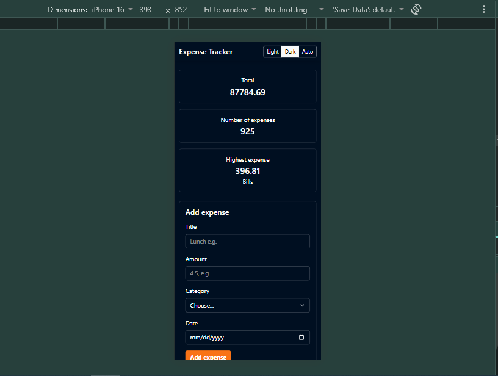
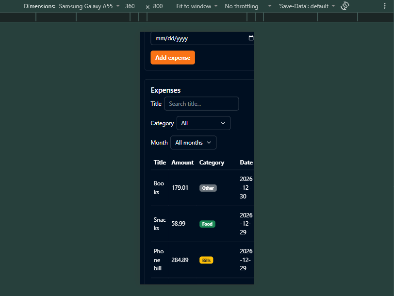
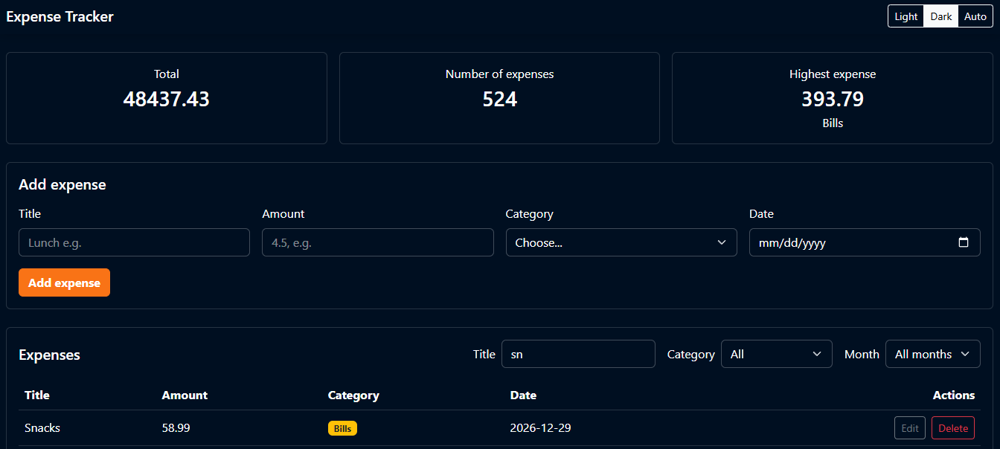

# Expense Tracker

This is a simple expense tracker web app. You can add your expenses, see them in a table, filter them, and see a summary of your spending. The data is saved in a PostgreSQL database, so it stays even after you close the browser.

## How to run

### Backend

1. Go to the `backend` folder in your terminal.
2. Run `npm install` to install the packages (express, pg, cors, dotenv).
3. Create a PostgreSQL database and run the `schema.sql` file to make the `expenses` table.
4. Copy `.env.example` to a new file called `.env` and put your database info in it (`DB_HOST`, `DB_PORT`, `DB_USER`, `DB_PASSWORD`, `DB_NAME`).
5. Run `node server.js` to start the server. It will run on `http://localhost:3000`.

### Frontend

1. Go to the `frontend` folder.
2. Open `index.html` with Live Server (or just open it in the browser).
3. Make sure the backend server is running, or the page will not get any data.

## Features

- Add an expense (with validation)
- Delete an expense
- Edit an expense
- Filter by category
- Summary cards (total, count, highest)
- Data is saved in a PostgreSQL database
- Light and dark modes
- Auto theme mode
- Filter by month
- Search by title

## Screenshots

### Responsive design

## What was the hardest part?

For me the hardest part was the bonus features: the dark/light theme toggle and the filters. These were not required, but I wanted to implement them in a good and professional way, so I did some research before writing the code.

For the theme toggle, the hardest part was something called "theme flashing". This means that if you choose dark mode and then reload the page, for a tiny moment the page shows light mode first and then changes to dark. This looks bad. To fix this, I learned that I need to put a small script inside the `<head>` of the HTML, and this script must run right away (not with `defer` or `async`), so it sets the theme before the page is even shown to the user. I also learned about `localStorage`, which is used to remember the theme choice even after closing the browser, and `matchMedia`, which lets the page check if the user's operating system itself is set to dark mode, for the "Auto" option.

## Repo link

[GitHub Repository](https://github.com/Ghaith256/expenses-tracker)

## Demo link

[Live Demo](https://drive.google.com/file/d/1lkxUTdQdVhZl-Z2NcttEzMrj5HA0LJAa/view?usp=sharing)
